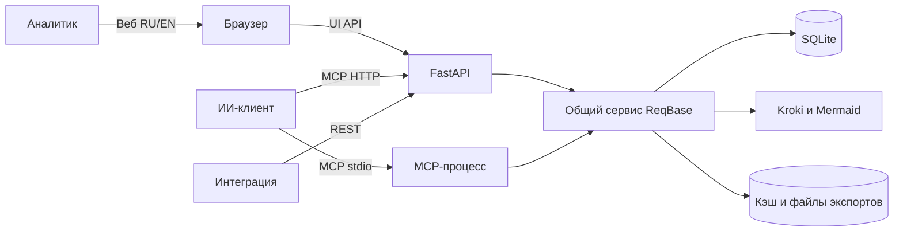
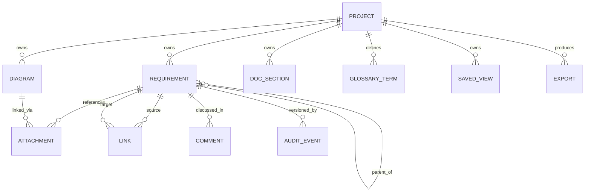
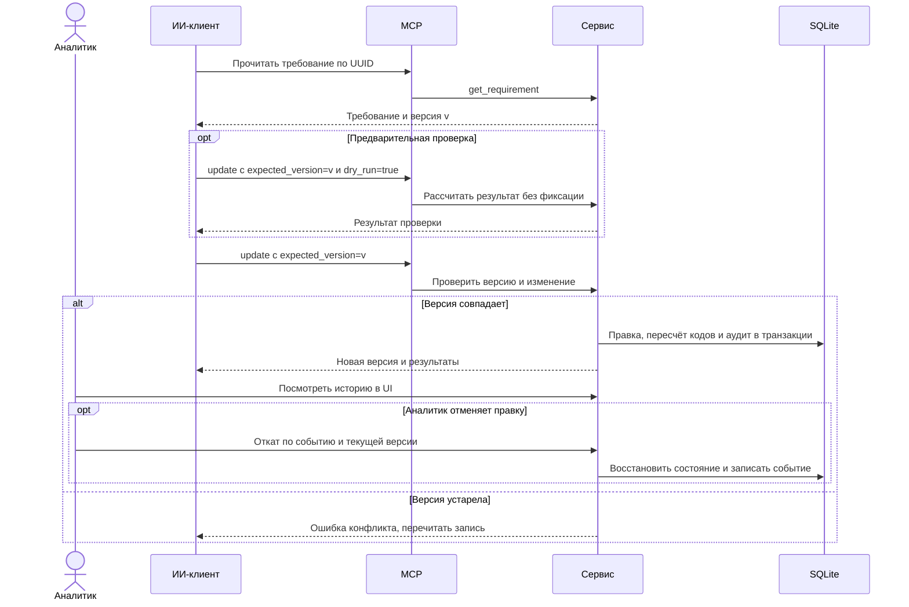
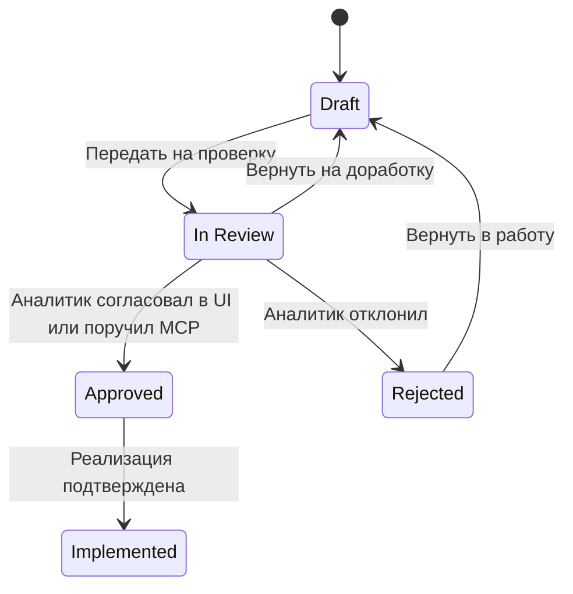

# ReqBase · BRD и SRS, редакция 0.1

Дата: 15 ноября 2026. Статус документа: черновик для согласования. Записи каталога создаются со статусом `Draft`. Идентификаторы в квадратных скобках — ключи спецификации; ReqBase хранит постоянный UUID и отдельно вычисляет код позиции в дереве.

## Бизнес-контекст и границы

**Проблема.** Требования, схемы и документы легко расходятся, если их правят независимо. При работе с ИИ аналитику также нужно видеть, какие изменения внесены и как их отменить.

**Цель.** Аналитик ведёт одну базу по каждому проекту, разбирает пробелы и выпускает BRD/SRS из её содержимого. ИИ работает с теми же записями через MCP, а аналитик проверяет результат в веб-интерфейсе.

**Решения владельца.** В первом релизе работают один аналитик и его ИИ-ассистент. Согласование — явная смена статуса на `Approved` аналитиком в UI или ассистентом через MCP по прямой команде аналитика. Отдельный маршрут согласования и утверждение снимка документа не требуются. MCP пишет напрямую; аудит и откат нужны для требований. `dry_run` — опция.

**Участники.** Аналитик ведёт реестр и согласует требования; ассистент подготавливает и правит записи; читатель получает выпущенный документ. Для читателя не требуется отдельная учётная запись ReqBase.

**Объём первого релиза.** Проекты, каталог BR/FR/NFR, схемы и связи, история, корзина, BRD/SRS, перенос данных, веб, REST и MCP. Многопользовательские роли, многоступенчатое согласование, утверждённый baseline и откат объектов кроме требований вне объёма.

**Как читать каталог.** `Есть` — поведение следует из реализации; факт проверки фиксируется отдельно. `Частично` — требование шире текущего поведения. `Предложение` — цель для обсуждения, включая численные SLO. Приоритеты предварительные. Источник BR: продуктовая гипотеза, уточнённая ответами владельца; источник FR/NFR — родительский BR, реализация и предлагаемые условия приёмки.

## Каталог требований

### [B01] Единый реестр требований
BR · Must · Есть

Аналитик ведёт каждый проект в одном реестре, от бизнес-потребности до проверяемых условий реализации.

- Приёмка: в сценарии с двумя проектами аналитик находит и меняет нужное требование; данные другого проекта не меняются.

#### [F01] Управление проектами
FR · Must · Есть

Создавать и редактировать проект с языком документа и реквизитами титульного листа, переключаться между проектами, удалять и восстанавливать проект.

- Приёмка: после восстановления доступен тот же проект с тем же UUID и его каталогом; требования и связи другого проекта не меняются.

#### [F02] Карточка требования и иерархия
FR · Must · Есть

Хранить название, описание, тип, источник, статус, приоритет, критерии приёмки и теги. BR — корень; FR/NFR — потомки BR. Переносить и упорядочивать ветки, сохраняя UUID и пересчитывая позиционные коды.

- Приёмка: после переноса FR под другое BR его UUID и связи сохраняются, отображаемый код меняется; попытка переместить ветку под её потомка отклоняется.

#### [F03] Поиск и рабочие представления
FR · Must · Есть

Открывать реестр деревом, таблицей или канбаном. Искать по коду, названию, описанию, источнику, тегам и критериям; фильтровать записи и сохранять рабочие представления.

- Приёмка: при поиске совпавшее дочернее требование видно вместе с предками; сохранённое представление повторно открывается с выбранным режимом и фильтрами.

#### [N01] Скорость работы с каталогом
NFR · Should · Предложение

Стартовый профиль нагрузки: 5 проектов по 1 000 активных требований, дерево глубиной до 6, один аналитик и один MCP-клиент. Зафиксировать конфигурацию стенда перед измерением.

- Приёмка: p95 открытия дерева и серверного поиска ≤ 2 с, p95 одиночной правки ≤ 1 с на локальном стенде после прогрева; замер по 30 операциям каждого вида, без рендера и экспорта.

#### [N02] Язык и работа с клавиатуры
NFR · Should · Частично

Поддерживать RU/EN и кириллицу. Выполнение базового сценария через клавиатуру должно быть доступно с видимым фокусом.

- Приёмка: на RU и EN открыть каталог, найти строку, открыть карточку, создать и отредактировать требование без мыши; данные с кириллицей сохраняются после перезагрузки.

### [B02] Проверяемое согласование и покрытие
BR · Must · Есть

Аналитик видит, зачем нужно каждое требование, каких деталей не хватает и что готово к работе. Согласование выполняется вручную сменой статуса на Approved.

- Приёмка: по выбранной цели видны FR/NFR и пробелы; аналитик может перевести требование в Approved и увидеть его в отборе согласованных.

#### [F04] Статусы, приоритеты и обсуждение
FR · Must · Есть

Поддерживать Draft, In Review, Approved, Implemented, Rejected и приоритеты Must, Should, Could, Won't. Поддерживать комментарии к требованию. Аналитик ставит Approved в UI либо явно поручает это ассистенту. Это правило работы ассистента: сервер сейчас не проверяет наличие пользовательской команды. Обязательные переходы не заданы.

- Приёмка: новое требование без явного статуса создаётся в Draft, аналитик добавляет комментарий и меняет статус на Approved; изменение статуса отражается в истории требования.

#### [F05] Матрица и диагностика пробелов
FR · Must · Есть

Показывать BR и его FR/NFR независимо от глубины вложения. Выявлять BR без FR, FR без BR, записи без критериев, BR без схем и Must в Draft. Трассировка по дереву и явные связи — разные механизмы.

- Приёмка: после добавления FR к пустому BR исчезает признак «BR без FR»; Must/Draft с пустым списком критериев попадает в обе соответствующие проверки.

#### [F06] Схемы и связи
FR · Must · Есть

Хранить редактируемые Mermaid/PlantUML, указывать вид схемы, связывать её с одним или несколькими требованиями; задавать depends_on, relates_to и conflicts_with. Предусмотреть просмотр и выгрузку рисунка.

- Приёмка: схема видна в двух связанных карточках; ссылка за пределы проекта или на то же требование отклоняется; при доступном рендере схема скачивается как SVG/PNG.

#### [N03] Работа при недоступности рендера
NFR · Should · Есть

Сохранение и чтение требований и исходников схем не должны зависеть от Kroki. Ошибка синтаксиса отличима от недоступности рендера; для Mermaid доступен локальный просмотр.

- Приёмка: отключить Kroki, сохранить и прочитать требование и схему; Mermaid открывается в локальном просмотре, а серверная операция для новой некэшированной схемы сообщает о проблеме рендера.

### [B03] Совместная работа аналитика и ИИ
BR · Must · Есть

ИИ напрямую обновляет тот же реестр через MCP. Аналитик видит результат, понимает происхождение изменения и может восстановить прежнее состояние в согласованных границах аудита.

- Приёмка: MCP меняет запись; аналитик находит событие в UI, видит автора, канал и правку, затем возвращает прежнее состояние.

#### [F07] Чтение и запись через MCP и REST
FR · Must · Есть

Предоставлять HTTP MCP и stdio, а также REST API с OpenAPI. Использовать общую модель данных. Поддерживать поиск/чтение и пакетное создание/правку требований; для мутаций предоставить предварительный прогон, где он предусмотрен контрактом.

- Приёмка: MCP показывает дерево, пакетный dry_run не создаёт записей, обычный вызов создаёт записи, а UI и REST читают эти же UUID.

#### [F08] Аудит и откат правок
FR · Must · Есть

Для правки требования показывать автора, канал, время и состояния до/после. Откатывать отдельное требование по событию его истории; откат оставляет новое событие. Пакет можно править атомарно, обратная операция выбирается отдельно по требованию.

- Приёмка: после MCP-правки требование возвращено к состоянию до выбранного события; аудит содержит обе операции.

#### [F09] Корзина и восстановление ветки
FR · Must · Есть

Удалять проект или ветку обратимо. Для ветки восстанавливать записи, удалённые одной операцией, и их идентичность; учитывать состояние родителя.

- Приёмка: удалённая ветка исчезает из дерева; после восстановления вернулись исходные UUID и ассоциации. Независимо удалённая ранее запись не восстанавливается вместе с веткой.

#### [N04] Защита от потери правок
NFR · Must · Есть

Проверять версию изменяемой записи и выполнять изменение требований, пересчёт кодов и аудит атомарно. Пакет не должен сохраняться частично. В REST при конфликте возвращать 409 и текущую запись.

- Приёмка: из двух параллельных правок с одной версией принимается одна; вторая получает конфликт. Пакет с некорректным элементом не оставляет новых записей или событий.

#### [N05] Локальный доступ и защита интерфейсов
NFR · Must · Есть

По умолчанию публиковать приложение на loopback. HTTP REST и MCP требуют Bearer-токен; UI работает без учётной записи с проверками Host, Origin при наличии и специального заголовка; доступ к stdio даёт запуск локального процесса. Метка X-Actor — атрибуция, а не доказательство личности.

- Приёмка: HTTP REST/MCP без действительного токена отвечают 401, запрос к UI с чужим Origin — 403, локальный UI открывается без регистрации. Проверка не предполагает защиту от другого локального процесса с доступом к машине.

### [B04] Выпуск документов и сохранность данных
BR · Must · Есть

Аналитик собирает BRD и SRS из текущего каталога и может перенести проект на другой экземпляр без повторного ручного ввода.

- Приёмка: на одном наборе данных сформированы BRD и SRS, сохранена копия проекта, из неё на отдельной базе восстановлены исходные идентификаторы.

#### [F10] Сборка и выгрузка BRD/SRS
FR · Must · Есть

Собирать BRD с BR и бизнес-разделами, SRS с FR/NFR, интерфейсами, матрицей BR→FR и приложением схем. Добавлять глоссарий, титул и критерии, применять фильтры по статусам и веткам. При выборе веток в приложение SRS включать только активные схемы, связанные с выбранными требованиями или их потомками, которые проходят фильтры статусов. Предоставлять предпросмотр и скачивание Markdown/PDF с записью об экспорте.

- Приёмка: BRD для выбранного FR включает его BR, если тот проходит фильтр статусов. «Только Approved» включает ровно этот статус. При выборе ветки приложение SRS включает активную схему, связанную с подходящим требованием ветки, и исключает несвязанные схемы, схемы соседних веток и схемы, связанные только с требованиями, отсеянными фильтром статусов. Общая схема появляется в приложении один раз. Без выбора веток приложение содержит все активные схемы проекта. Сохранённый файл не меняется после правки требований.

#### [F11] Импорт и резервная копия
FR · Must · Есть

Использовать CSV для активной иерархии, JSON для снимка проекта и его истории. При восстановлении отдельного проекта сохранять UUID, при импорте в имеющийся проект назначать новые UUID и переносить активные связи. Файлы экспортов сохранять отдельно от JSON.

- Приёмка: восстановление на чистом экземпляре возвращает UUID и историю; два импорта без коллизий создают новые UUID. Некорректный импорт не меняет проект.

#### [N06] Допустимая потеря данных и время восстановления
NFR · Should · Предложение

Для локального развёртывания предложены RPO ≤ 24 ч и RTO ≤ 60 мин. Резервировать согласованную копию SQLite и хранилища файлов экспортов; кэш рендера допускается пересобрать. Автоматическое расписание и срок хранения нужно согласовать.

- Приёмка: восстановить копию на чистом стенде за 60 минут, проверить проект, UUID, связи, историю и открытие ранее выпущенного файла; самой свежей доступной копии не более 24 часов.

## Схемы

### [D01] Контекст и компоненты
component · B01,F07,N05

### [D02] Логическая модель проекта
ER · B02,B04,F02,F06,F08,F10

Логическая схема; физически SQLite хранит агрегат проекта в JSON.

### [D03] Запись через MCP и конфликт версий
sequence · B03,F07,F08,N04

### [D04] Рабочий процесс согласования
state · B02,F04,F10

Рекомендуемый порядок работы. Текущий сервер принимает смену на любое допустимое значение статуса и не проверяет переходы по этой схеме. Корзина — отдельный признак, не статус согласования.

## Вопросы для следующего прохода

1. Должен ли экспорт «Только Approved» включать `Implemented`? Сейчас отбор сравнивает статус с `Approved` точно. Если реализация не отменяет согласование, стоит добавить отдельный отбор «Согласованные и реализованные».
2. Достаточны ли для первого релиза 1 000 требований на проект и резервирование раз в сутки? Целевые значения производительности и восстановления пока предложены.

## Глоссарий

- **BRD** — документ о бизнес-потребностях, целях, границах и BR.
- **SRS** — спецификация функций, качественных характеристик, интерфейсов и трассировки.
- **BR / FR / NFR** — бизнес-, функциональное и нефункциональное требование соответственно.
- **UUID и код** — постоянный идентификатор записи и изменяемый код её позиции в дереве.
- **MCP** — протокол, через который ИИ-клиент обнаруживает инструменты ReqBase и обращается к ним.
- **RPO / RTO** — допустимый период потери данных и допустимое время восстановления.
